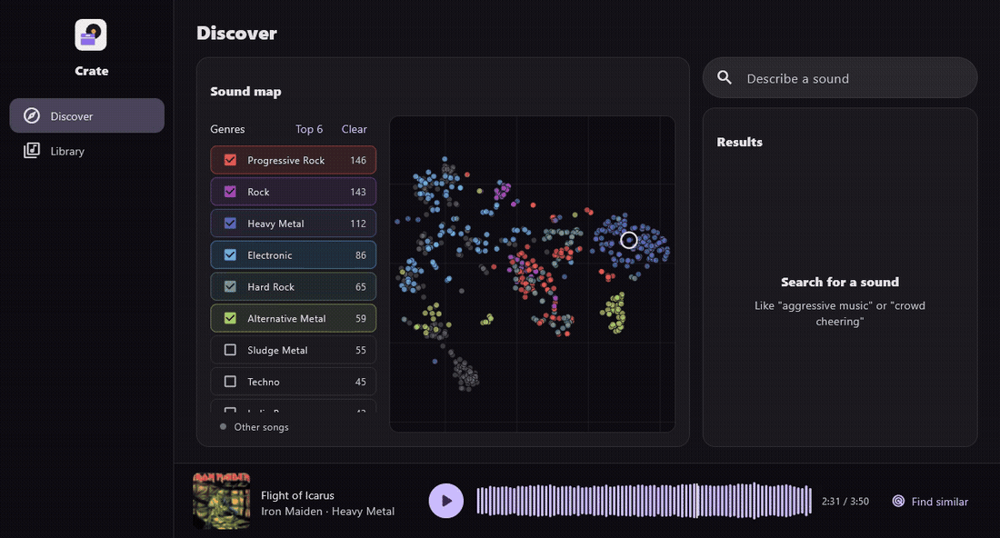

# Crate

Crate digging through your own music library. Describe a sound and Crate finds the songs that sound like it and plays them from the part that matches best.

Search runs on [SonicEmbed](https://huggingface.co/jaisawhney/SonicEmbed), a music and text embedding model I fine-tuned from EmbeddingGemma. Inference runs on your computer through LiteRT-LM, and your songs are never uploaded.



## Key Features

- Search by sound
  - Every song is split into 10 second embedded moments
  - Results start playing at the moment that best matches your description
- Similar song search
  - Pick a spot in the currently playing song and find other songs with matching moments
- Sound map
  - t-SNE projection of each song's mean embedding
  - Colored by genre tag to compare tags against the embeddings
- Waveform player
  - A seekable waveform with the moments that match the search highlighted

## Tech Stack

**ML:** SonicEmbed (EmbeddingGemma fine-tune), LiteRT-LM via flutter_edge_ai

**App:** Flutter, Dart, Riverpod, ObjectBox

**Audio:** just_audio with [my fork](https://github.com/jaisawhney/just_audio_media_kit) of just_audio_media_kit (mpv)

## How It Works

1. Songs are decoded to 16 kHz mono with FFmpeg and cut into 10 second windows.
2. SonicEmbed turns each window into a 768-number embedding, stored in ObjectBox.
3. A search embeds your text the same way and compares it against every window. Each song keeps its best match.
4. The sound map averages a song's windows into one embedding and runs t-SNE on those.

## Building Yourself

### Prerequisites

- Flutter 3.50+
- libmpv on Linux (untested).

### Build and run

```bash
flutter pub get
flutter run -d windows
```

### Regenerate the ObjectBox bindings

```bash
dart run build_runner build
```

## AI Disclosure

Agentic coding was used during the creation of this project as a development aid. Crate's design and direction are my own work.
